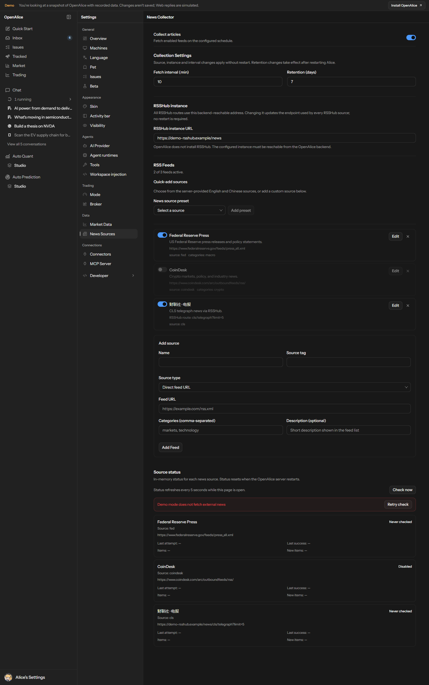

# 新闻源清单

<!-- Generated by scripts/generate-news-sources.ts. Edit the server catalog, then regenerate. -->

供用户和维护者查看内置来源、选择订阅。当前目录共 **49 个来源**，其中 **34 个直连源**、**15 个 RSSHub 来源**。

这是一张可选来源目录，不是当前用户订阅表，也不是全部来源可用的承诺。新配置初始状态只描述未提供自定义 feeds 时的默认列表；目录中的按需添加项不会自动订阅，生成清单也不会读取或修改用户配置。

## 按国家/地区浏览

地区表示频道的覆盖侧重；同一来源可覆盖多个地区，各行数量不能相加当作独立来源总数。“全球”表示跨地区覆盖。市场/主题可进一步筛选股票、宏观、外汇、商品、债券、基金、加密资产、人工智能和科技。

目录分类只用于浏览；不改变已保存订阅、采集器、原文标签，也不代表每条新闻影响的国家或资产。自定义或旧目录中缺少覆盖信息的来源显示未分类，不从语言或名称猜测。

| 覆盖地区 | 来源数 | 来源 |
|---|---|---|
| 中国内地 | 9 | SCMP Business、SCMP Economy、财联社 · 电报、格隆汇 · 实时快讯、华尔街见闻 · A 股、金融界 · 财经、金融界 · A 股、金融界 · 基金、金融界 · 债券 |
| 中国香港 | 5 | SCMP Business、SCMP Economy、格隆汇 · 实时快讯、华尔街见闻 · 港股、金融界 · 港股 |
| 美国 | 15 | Federal Reserve Press、MarketWatch Top Stories、WSJ Markets、CNBC Economy、MarketWatch Real-time、Yahoo Finance、Seeking Alpha、WSJ Business、NYT Business、NYT Economy、CNBC Finance、CNBC Top News、CNBC Markets、华尔街见闻 · 美股、金融界 · 美股 |
| 欧洲 | 1 | ECB Press |
| 日本 | 1 | Nikkei Asia |
| 亚太 | 1 | Nikkei Asia |
| 全球 | 24 | WSJ Business、WSJ World News、NYT Business、FT Home、The Economist Finance、CNBC Top News、TechCrunch、The Verge、Ars Technica、OpenAI News、Google DeepMind、Google Research、Hugging Face Blog、Microsoft Research、NVIDIA Blog、CoinDesk、CoinTelegraph、The Block、Bitcoin Magazine、Decrypt、金十数据 · 市场快讯、华尔街见闻 · 全球快讯、华尔街见闻 · 外汇、华尔街见闻 · 商品 |

## 来源表

| 名称 | 接入方式 | source 标签 | URL / 相对路由 | 覆盖地区 | 市场/主题 | 新配置初始状态 |
|---|---|---|---|---|---|---|
| Federal Reserve Press | RSS / Atom 直连 | fed | https://www.federalreserve.gov/feeds/press_all.xml | 美国 | 宏观、债券 | 初始启用 |
| ECB Press | RSS / Atom 直连 | ecb | https://www.ecb.europa.eu/rss/press.html | 欧洲 | 宏观、债券、外汇 | 初始启用 |
| MarketWatch Top Stories | RSS / Atom 直连 | marketwatch | https://feeds.marketwatch.com/marketwatch/topstories/ | 美国 | 股票 | 初始启用 |
| WSJ Markets | RSS / Atom 直连 | wsj-markets | https://feeds.content.dowjones.io/public/rss/RSSMarketsMain | 美国 | 股票 | 初始启用 |
| CNBC Economy | RSS / Atom 直连 | cnbc-economy | https://search.cnbc.com/rs/search/combinedcms/view.xml?partnerId=wrss01&id=20910258 | 美国 | 宏观 | 初始启用 |
| MarketWatch Real-time | RSS / Atom 直连 | marketwatch-pulse | http://feeds.marketwatch.com/marketwatch/marketpulse/ | 美国 | 股票 | 初始停用 |
| Yahoo Finance | RSS / Atom 直连 | yahoo-finance | https://finance.yahoo.com/news/rssindex | 美国 | 股票 | 初始停用 |
| Seeking Alpha | RSS / Atom 直连 | seekingalpha | https://seekingalpha.com/feed.xml | 美国 | 股票 | 初始停用 |
| WSJ Business | RSS / Atom 直连 | wsj-business | https://feeds.a.dj.com/rss/RSSWSJD.xml | 美国、全球 | 股票 | 初始停用 |
| WSJ World News | RSS / Atom 直连 | wsj-world | https://feeds.a.dj.com/rss/RSSWorldNews.xml | 全球 | 宏观 | 初始停用 |
| NYT Business | RSS / Atom 直连 | nyt-business | https://rss.nytimes.com/services/xml/rss/nyt/Business.xml | 美国、全球 | 股票 | 初始停用 |
| NYT Economy | RSS / Atom 直连 | nyt-economy | https://rss.nytimes.com/services/xml/rss/nyt/Economy.xml | 美国 | 宏观 | 初始停用 |
| FT Home | RSS / Atom 直连 | ft | https://www.ft.com/rss/home | 全球 | 股票、宏观 | 初始停用 |
| The Economist Finance | RSS / Atom 直连 | economist-finance | https://www.economist.com/finance-and-economics/rss.xml | 全球 | 宏观、股票 | 初始停用 |
| CNBC Finance | RSS / Atom 直连 | cnbc | https://search.cnbc.com/rs/search/combinedcms/view.xml?partnerId=wrss01&id=10000664 | 美国 | 股票 | 初始停用 |
| CNBC Top News | RSS / Atom 直连 | cnbc-top | https://search.cnbc.com/rs/search/combinedcms/view.xml?partnerId=wrss01&id=100003114 | 美国、全球 | 股票、宏观 | 初始停用 |
| CNBC Markets | RSS / Atom 直连 | cnbc-markets | https://search.cnbc.com/rs/search/combinedcms/view.xml?partnerId=wrss01&id=15839069 | 美国 | 股票 | 初始停用 |
| TechCrunch | RSS / Atom 直连 | techcrunch | https://techcrunch.com/feed/ | 全球 | 科技 | 初始停用 |
| The Verge | RSS / Atom 直连 | theverge | https://www.theverge.com/rss/index.xml | 全球 | 科技 | 初始停用 |
| Ars Technica | RSS / Atom 直连 | arstechnica | https://feeds.arstechnica.com/arstechnica/index | 全球 | 科技 | 初始停用 |
| OpenAI News | RSS / Atom 直连 | openai-news | https://openai.com/news/rss.xml | 全球 | 人工智能、科技 | 初始停用 |
| Google DeepMind | RSS / Atom 直连 | google-deepmind | https://deepmind.google/blog/rss.xml | 全球 | 人工智能、科技 | 初始停用 |
| Google Research | RSS / Atom 直连 | google-research | https://research.google/blog/rss/ | 全球 | 人工智能、科技 | 初始停用 |
| Hugging Face Blog | RSS / Atom 直连 | hugging-face | https://huggingface.co/blog/feed.xml | 全球 | 人工智能、科技 | 初始停用 |
| Microsoft Research | RSS / Atom 直连 | microsoft-research | https://www.microsoft.com/en-us/research/feed/ | 全球 | 人工智能、科技 | 初始停用 |
| NVIDIA Blog | RSS / Atom 直连 | nvidia-blog | https://blogs.nvidia.com/feed/ | 全球 | 人工智能、科技 | 初始停用 |
| Nikkei Asia | RSS / Atom 直连 | nikkei-asia | https://asia.nikkei.com/rss/feed/nar | 日本、亚太 | 股票、宏观 | 初始启用 |
| SCMP Business | RSS / Atom 直连 | scmp-business | https://www.scmp.com/rss/91/feed | 中国内地、中国香港 | 股票 | 初始启用 |
| SCMP Economy | RSS / Atom 直连 | scmp-economy | https://www.scmp.com/rss/92/feed | 中国内地、中国香港 | 宏观 | 初始停用 |
| CoinDesk | RSS / Atom 直连 | coindesk | https://www.coindesk.com/arc/outboundfeeds/rss/ | 全球 | 加密资产 | 初始启用 |
| CoinTelegraph | RSS / Atom 直连 | cointelegraph | https://cointelegraph.com/rss | 全球 | 加密资产 | 初始停用 |
| The Block | RSS / Atom 直连 | theblock | https://www.theblock.co/rss.xml | 全球 | 加密资产 | 初始停用 |
| Bitcoin Magazine | RSS / Atom 直连 | bitcoinmagazine | https://bitcoinmagazine.com/feed | 全球 | 加密资产 | 初始停用 |
| Decrypt | RSS / Atom 直连 | decrypt | https://decrypt.co/feed | 全球 | 加密资产 | 初始停用 |
| 财联社 · 电报 | RSSHub | cls | cls/telegraph | 中国内地 | 股票、宏观 | 按需添加 |
| 格隆汇 · 实时快讯 | RSSHub | gelonghui | gelonghui/live | 中国内地、中国香港 | 股票 | 按需添加 |
| 金十数据 · 市场快讯 | RSSHub | jin10 | jin10 | 全球 | 宏观、外汇、商品 | 按需添加 |
| 华尔街见闻 · 全球快讯 | RSSHub | wallstreetcn | wallstreetcn/live/global | 全球 | 股票、宏观、外汇、商品 | 按需添加 |
| 华尔街见闻 · A 股 | RSSHub | wallstreetcn-a | wallstreetcn/live/a-stock | 中国内地 | 股票 | 按需添加 |
| 华尔街见闻 · 港股 | RSSHub | wallstreetcn-hk | wallstreetcn/live/hk-stock | 中国香港 | 股票 | 按需添加 |
| 华尔街见闻 · 美股 | RSSHub | wallstreetcn-us | wallstreetcn/live/us-stock | 美国 | 股票 | 按需添加 |
| 华尔街见闻 · 外汇 | RSSHub | wallstreetcn-fx | wallstreetcn/live/forex | 全球 | 外汇、宏观 | 按需添加 |
| 华尔街见闻 · 商品 | RSSHub | wallstreetcn-commodities | wallstreetcn/live/commodity | 全球 | 商品 | 按需添加 |
| 金融界 · 财经 | RSSHub | jrj | jrj/103 | 中国内地 | 股票、宏观 | 按需添加 |
| 金融界 · A 股 | RSSHub | jrj-a | jrj/010 | 中国内地 | 股票 | 按需添加 |
| 金融界 · 港股 | RSSHub | jrj-hk | jrj/001 | 中国香港 | 股票 | 按需添加 |
| 金融界 · 美股 | RSSHub | jrj-us | jrj/102 | 美国 | 股票 | 按需添加 |
| 金融界 · 基金 | RSSHub | jrj-funds | jrj/104 | 中国内地 | 基金 | 按需添加 |
| 金融界 · 债券 | RSSHub | jrj-bonds | jrj/118 | 中国内地 | 债券 | 按需添加 |

RSSHub 路由使用设置页的共享实例地址；切换实例只影响 RSSHub 来源，不改变普通直连 URL。RSSHub 是用户自行提供、可从 Alice 后端访问的外部服务；OpenAlice 不安装或托管它。

## 使用与兼容

- 在新闻页点击“浏览信息源”进入 Settings → News Sources；目录支持国家/地区与市场/主题的组合筛选、中文覆盖标签搜索和结果计数，来源卡片显示分类、直连 / RSSHub 要求及是否已添加。已订阅来源也显示匹配目录的覆盖标签。须显式添加目录项，也可添加或编辑自定义来源；浏览目录不会改写现有订阅，添加时不把目录分类写入订阅或原文标签。
- 保存后来源、启停、间隔、共享实例地址与内存策略应用到运行中的单一采集器；在途采集先结束，再使用新配置。内存按发布时间保留最近条目，迟到的旧消息不会挤掉较新消息；减小内存窗口不删除持久归档。
- 旧配置中的完整 URL 保持原样，即使它指向 RSSHub；只有明确设为 RSSHub 相对路由的订阅才跟随共享实例地址。可通过编辑来源、显式选择 RSSHub 类型来转换，不自动迁移或替换订阅。
- 社区非 RSS producer 的导入、代码批准、版本选定、订阅及故障重试见[模块设计与操作契约](news-modules/sdd.md)。模块以后台 OS 用户权限运行，不是沙箱；批准模块等于信任其文件、网络、子进程和同用户数据访问能力，失控模块可能耗尽后台内存。
- 新增官方信源、公司公告与商品报告、X/FMP，以及更多地区和微信等渠道留待后续，本轮不提供这些新接入。通用 v2 模块契约与凭据隔离能力见上述模块指南。
- RSSHub 服务 key 通过独立后台接口密封存储；不要填入普通 URL 或 RSSHub 路由。显式 RSSHub route 的 key/code 不存入普通配置；普通 direct RSS URL 的查询语义保持原样。密封保护落盘，不阻止同一 OS 用户获准模块访问该密钥。更换有 key 的实例先清除、改基址、重录。非 loopback 须 HTTPS；源站 Cookie/Token 由 RSSHub 运营者维护。

## 可用性边界

- 清单生成不联网；收录和初始启用均不代表验证通过，公共实例与自建实例的可用性可能不同。
- 当前订阅、启用状态和采集健康度，以 Settings → News Sources 中的用户配置和 Source status 为准。状态与最近成功、失败信息仅保存在进程内，重启后重新采集，不是历史可用性记录。
- Source status 区分请求结果和最近成功批次的最新发布时间，并显示缺失日期、未提供正文、跳过空条目与请求耗时。合法空 feed 的最新发布时间为空；低频官方来源不能仅按消息年龄判定故障。新 RSS 记录缺失发布时间时保留采集时间并标注其依据，不回填或猜测旧记录。
- 健康记录按订阅 ID（包括旧配置未提供 ID）、source 标签及实际请求 URL 识别；只改名称、分类或采集间隔会保留记录，改变来源身份则重置。无法区分的重复旧订阅在重新配置时重置，不借用另一行的成功记录。
- HTTP 200 不等于健康：响应须具有受支持的 RSS / Atom 外层结构，RSS / RDF 须包含直接子级 channel。合法空 feed 可以成功；这不是完整 XML 或 RFC 合规校验。
- 单次 RSS/Atom HTTP 响应最多读取 8 MiB；模块导入请求体在解析 JSON 前受限，单制品最多 8 MiB。超限拒绝，不把截断内容标为成功。
- 华尔街见闻与金融界的新增频道依据 RSSHub 官方 route 定义收录（wallstreetcn/live/:category?/:score? 与 jrj/:channelNum）；频道数不等于独立出版者数，本次未据此承诺实例或上游实时可用。

## 界面示例

下面是 Demo 模式的设置页：添加来源、编辑相对路由及修改共享实例地址后，直连 URL 保持不变。Demo 不联网采集，手动检查会明确拒绝，不把示例数据标记为已采集成功。

## 维护

[服务端来源目录](../src/domain/news/config.ts)是来源定义的唯一权威入口，也提供设置页的可选来源。新增、删除或修改内置来源后，从仓库根目录运行：

    pnpm exec tsx scripts/generate-news-sources.ts

把生成的表格随目录变更一同维护，不手改本文件的来源行，不另写一份前端预设列表。运行此命令不联网、不启动 collector，不采集新闻。
